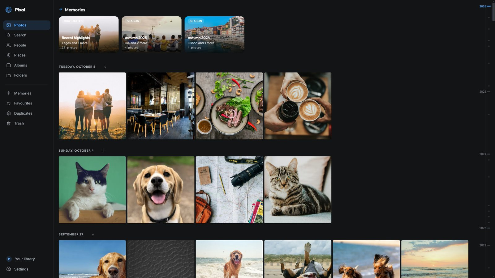
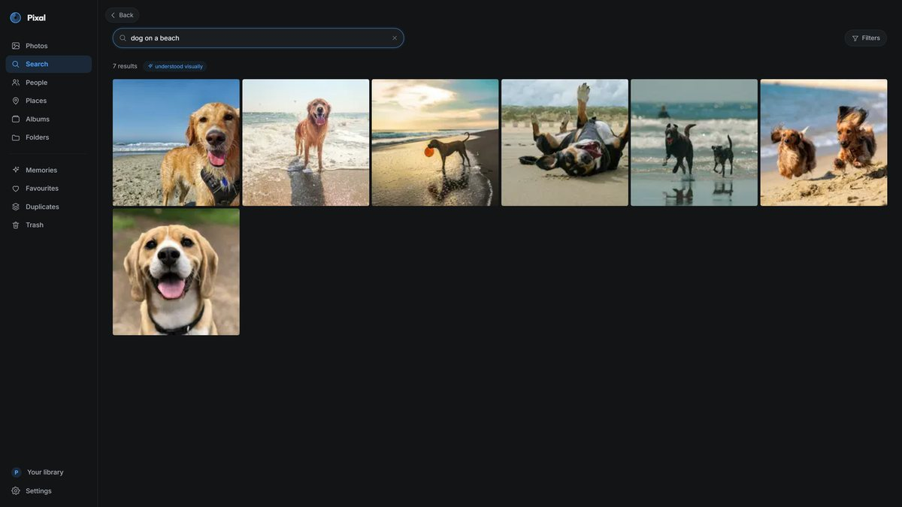
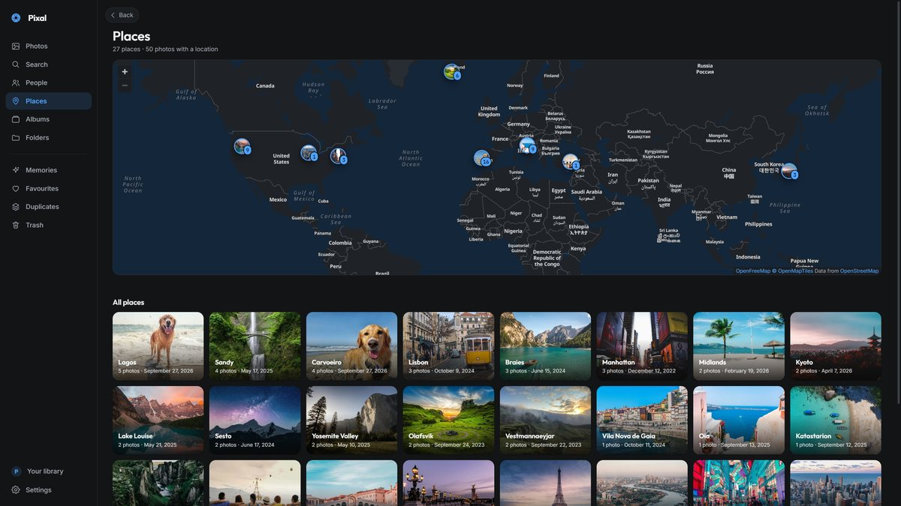
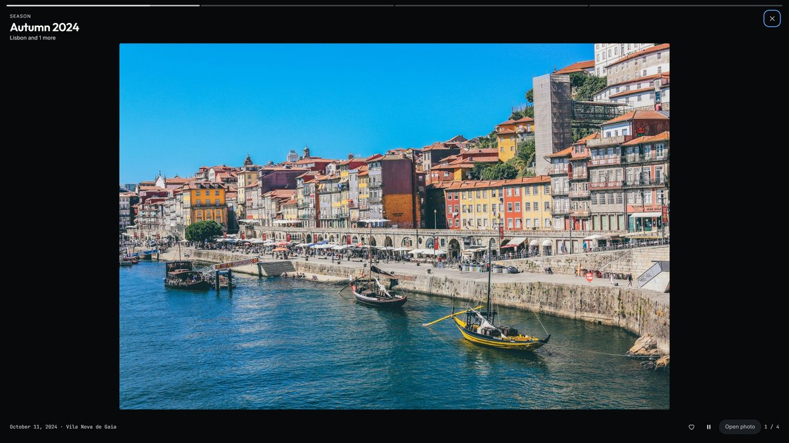
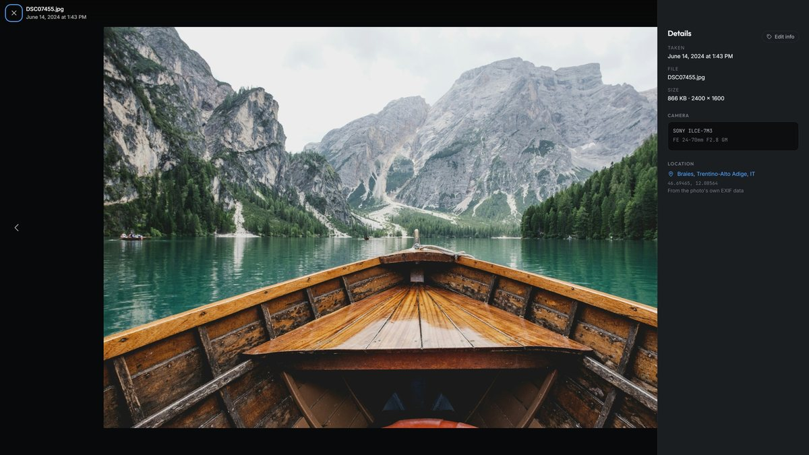

<div align="center">

<a href="https://github.com/Nouman-wp/pixal-releases/releases"></a>

<br><br>


# Pixal

**All the convenience of Google Photos. On your own machine.**

A fast, private photo manager for the library you already have: timeline, people, search, places and memories, with every photo, face and place kept on your PC. No account, no cloud, no tracking.

[](https://github.com/Nouman-wp/pixal-releases/releases/latest)
[](https://github.com/Nouman-wp/pixal-releases/releases)
[](https://pixal.caspx.in/downloads)
[](https://pixal.caspx.in)

[**Download**](https://pixal.caspx.in/downloads) · [Microsoft Store](https://apps.microsoft.com/detail/9n51r1t3b1bz) · [What's new](https://pixal.caspx.in/changelog) · [Website](https://pixal.caspx.in) · [Privacy](https://pixal.caspx.in/privacy) · [Report a bug](https://pixal.caspx.in/report)

<br>



</div>

## Download

| Platform | Get it | |
| --- | --- | --- |
| **Windows 10 and 11** | [**Microsoft Store**](https://apps.microsoft.com/detail/9n51r1t3b1bz) (recommended) | Installs in one click and keeps Pixal up to date for you |
| | [Installer (.exe)](https://pixal.caspx.in/download?os=windows) | The newest `Pixal-Setup` from the [latest release](https://github.com/Nouman-wp/pixal-releases/releases/latest) |
| **macOS** | Coming soon | Early test builds are attached to each release |
| **Linux** | Coming soon | Early test builds are attached to each release |

Every release is on the **[releases page](https://github.com/Nouman-wp/pixal-releases/releases)**, with its notes, every installer and a `SHA256SUMS.txt`.

<details>
<summary><b>Which file do I need?</b></summary>
<br>

| File | For |
| --- | --- |
| `Pixal-Setup-v<version>.exe` | Windows 10 and 11, 64-bit |
| `Pixal-<version>-mac-arm64.dmg` | Macs with Apple silicon (M1 and newer). Test build |
| `Pixal-<version>-mac-x64.dmg` | Intel Macs. Test build |
| `Pixal-<version>-linux-x86_64.AppImage` | Most Linux distributions, x64. Test build |
| `Pixal-<version>-linux-amd64.deb` | Debian and Ubuntu, x64. Test build |
| `SHA256SUMS.txt` | Checksums for every file above |

The Mac and Linux builds are for testing and aren't supported yet, so the website doesn't offer them.

</details>

## What Pixal does

- **Timeline** grouped by day, with a scrubber that jumps to any date
- **Search** by what's in a photo ("dog on a beach"), or by person, place, date, camera, file type and text inside photos
- **People**: faces are grouped automatically; name someone once and find them everywhere
- **Places**: a map of everywhere you've been, built from your photos' own GPS, with a fully offline map option
- **Memories** of past trips, seasons and this day in earlier years, played as stories
- **Albums, favourites** and suggested trip albums
- **Duplicates**: find identical and near-identical shots
- **Editing**: crop, rotate, adjust and filters, without touching the original
- **Share** to a phone on the same Wi-Fi with a QR code, with nothing uploaded
- **Export** to a folder or a zip, with your edits applied
- Photos and videos together, including iPhone HEIC
- Your original files are never moved, renamed or changed

<table>
  <tr>
    <td width="50%"><p align="center"><sub>Search by what's in the photo</sub></p></td>
    <td width="50%"><p align="center"><sub>Every place, on one map</sub></p></td>
  </tr>
  <tr>
    <td width="50%"><p align="center"><sub>Memories, played as stories</sub></p></td>
    <td width="50%"><p align="center"><sub>Every detail, from the photo itself</sub></p></td>
  </tr>
</table>

## Installing

1. **Install.** Get Pixal from the Microsoft Store, or run `Pixal-Setup-v<version>.exe` and follow the wizard. No account, email or licence key, and no administrator password.
2. **First launch.** Pixal sets up its processing engine once. It takes a few minutes and needs an internet connection.
3. **Add a folder.** Choose any folder of photos. Your timeline, places and memories fill in within seconds, and faces group in the background.
4. **Optional extras.** Natural-language search and text-in-photo search are separate downloads you can add later from Settings → Models.

After setup, everything Pixal does with your photos happens on your PC.

> **"Windows protected your PC"?** That SmartScreen warning appears for any installer Windows hasn't seen downloaded often yet. Choose **More info → Run anyway**, or install from the [Microsoft Store](https://apps.microsoft.com/detail/9n51r1t3b1bz), which avoids it.

### Updating

- **Microsoft Store:** updates arrive on their own.
- **Installer:** download the new version from the [releases page](https://github.com/Nouman-wp/pixal-releases/releases/latest) and run it over the old one. Your library and settings are kept. Pixal can tell you when a new version is out: turn on **Check for updates** in Settings → Privacy, or press **Check now** in Settings → About.

### Checking a download

Each release lists the SHA-256 of every file in `SHA256SUMS.txt`. Compare it with yours:

```powershell
# Windows (PowerShell)
Get-FileHash .\Pixal-Setup-v1.0.8.exe -Algorithm SHA256
```

```sh
# macOS
shasum -a 256 -c SHA256SUMS.txt --ignore-missing
# Linux
sha256sum -c SHA256SUMS.txt --ignore-missing
```

## Privacy

Indexing, faces and search all run on your PC, and nothing from your library is ever uploaded. Pixal has no account, analytics, ads or crash reporter. It goes online only for the few things listed in the [privacy policy](https://pixal.caspx.in/privacy), such as map tiles while you look at the Places map, and most of them can be switched off.

## Requirements

- Windows 10 (version 1809 or later) or Windows 11, 64-bit
- An internet connection for the first launch and for optional extras

## Help and feedback

- **Bugs:** use **Report a bug** in Pixal (Settings → About), the [bug report form](https://pixal.caspx.in/report) on the website, or open an [issue](https://github.com/Nouman-wp/pixal-releases/issues).
- **Ideas and questions:** [pixal.caspx.in/contact](https://pixal.caspx.in/contact)
- **Security issues:** please report them privately, as described in [SECURITY.md](SECURITY.md).

<div align="center">
<br>
<sub>This repository hosts Pixal's installers and release notes. Made by <a href="https://pixal.caspx.in">Caspx.in</a>.</sub>
</div>
